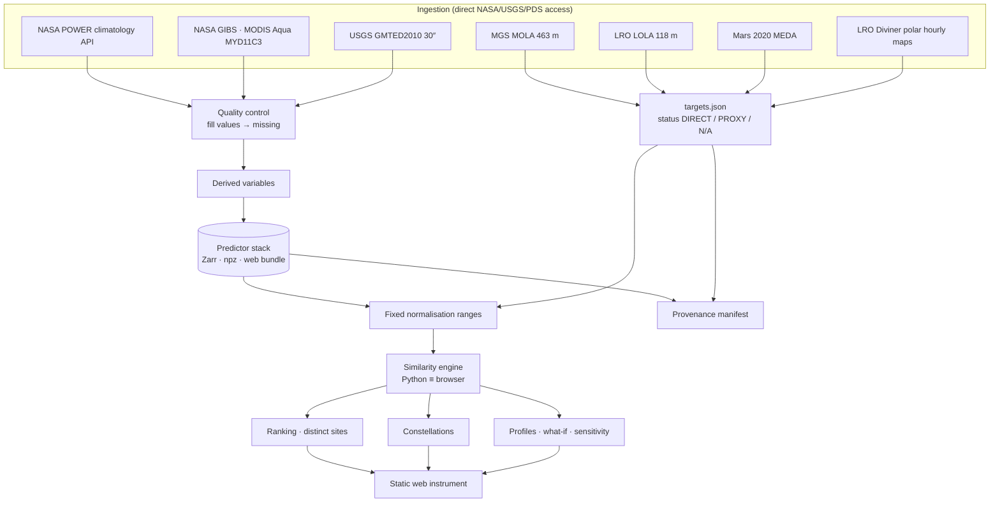

# ASTERRO — Planetary Analogue Intelligence

**Find Earth's environmental analogues for worlds beyond Earth.**

ASTERRO is a deterministic planetary analogue engine built for the NASA Space Apps Challenge 2026.

* Earth is a grid of **76,781 land cells**.
* Mars's Jezero Crater and the Moon's south pole are turned into environmental fingerprints built
  from mission data.
* Every Earth cell gets an **Analogue Score**: a weighted, range-normalised similarity under a
  stated weighting profile.
* Every number traces back to a named NASA / USGS / PDS dataset, and every result can be reproduced
  from a pinned, checksummed predictor stack.

> **What a score means.** ASTERRO identifies environmental analogues using selected, measurable
> variables. A high Analogue Score means *similar values of those modelled variables under the
> chosen weights*. It does **not** establish geological equivalence, engineering suitability,
> habitability, safety, or mission-site certification. The rankings have **not** been validated
> against field studies (see §22).

Algorithm version: `tai-sim-1.0.0` · Predictor stack SHA-256:
`cfbe1bf5fab5497b3d16bfc368eb4202ffaf2b5a1257bfd85f6834e735f72e63`

---

## Contents

1. [Overview](#1-overview)
2. [Scientific question](#2-scientific-question)
3. [Interpreting an Analogue Score](#3-interpreting-an-analogue-score)
4. [Features](#4-features)
5. [Architecture](#5-architecture)
6. [Data sources](#6-data-sources)
7. [Earth predictor stack](#7-earth-predictor-stack)
8. [Target fingerprints](#8-target-fingerprints)
9. [Criterion status: DIRECT / PROXY / N/A](#9-criterion-status-direct--proxy--na)
10. [Similarity mathematics](#10-similarity-mathematics)
11. [Normalisation](#11-normalisation)
12. [Missing data and weight coverage](#12-missing-data-and-weight-coverage)
13. [Ranking, tie-break and distinct sites](#13-ranking-tie-break-and-distinct-sites)
14. [Weighting profiles and sensitivity](#14-weighting-profiles-and-sensitivity)
15. [Analogue constellations](#15-analogue-constellations)
16. [Reverse search, cross-planet and discovery](#16-reverse-search-cross-planet-and-discovery)
17. [Analogue evolution](#17-analogue-evolution)
18. [Data quality indicator](#18-data-quality-indicator)
19. [Trace and reproduce](#19-trace-and-reproduce)
20. [Provenance manifest](#20-provenance-manifest)
21. [Testing and verification](#21-testing-and-verification)
22. [Limitations and unverified items](#22-limitations-and-unverified-items)
23. [Quick start](#23-quick-start)
24. [Rebuilding from raw data](#24-rebuilding-from-raw-data)
25. [Deployment and publishing](#25-deployment-and-publishing)
26. [Repository structure and configuration](#26-repository-structure-and-configuration)
27. [Licence, attribution and media policy](#27-licence-attribution-and-media-policy)

---

## 1. Overview

The engine asks one question of every Earth land cell: how close is this place to a selected
off-world environment, on six measurable criteria? It answers with a transparent formula. No
language model or learned model computes, alters, ranks, clusters or explains any number.

The web instrument is a single static page with a WebGL globe and map. Its engine is a
line-for-line port of the Python reference engine. The two produce bitwise-identical scores.

## 2. Scientific question

*Where on Earth can we find environments that quantitatively resemble a selected lunar or
Martian environment?*

"Resemble" means *similar values of the selected modelled variables*. The following are **not**
modelled:

* gravity
* atmospheric composition and pressure (except through the elevation proxy, §9)
* radiation
* geology and mineralogy
* regolith
* day length
* spatial scale

## 3. Interpreting an Analogue Score

* The score is in **[0, 1]** and is shown as a percentage, always labelled "under <profile>". The
  same cell has different scores under different weighting profiles.
* The labels **Match** (≥ 0.85), **Partial** (≥ 0.60) and **Mismatch** (< 0.60) are fixed display
  thresholds, not statistical tests.
* A score is only as meaningful as its inputs. Two of the six criteria are **proxies** for both
  targets, and one is **not applicable** to the Moon (§9).
* The data quality indicator (§18) is shown separately from the score. It is not a confidence
  interval.

## 4. Features

* **Explore**
  * 3D globe and flat map of the Analogue Score field.
  * Target fingerprint shown as a radial chart and as Analogue DNA.
  * Match / partial / mismatch breakdown for each criterion.
* **Weights**: mission profiles, custom weights and "What if?" transforms.
* **Why did this move?**: exact decomposition of rank and score changes after a weight change.
* **Stability and site discovery**
  * Ranking stability across profiles.
  * Distinct sites at least 300 km apart.
  * Analogue constellations (deterministic k-means).
* **Search modes**
  * Reverse search: click any cell to see its scores and ranks.
  * Cross-planet mode, with a Pareto set.
  * Discovery graph and latitude-gap view.
* **Analogue evolution**: yearly MODIS data, 2016–2025.
* **Transparency**
  * Trace Result: from dataset to raw value to normalisation to weight to contribution to score.
  * Reproduce This Result: exports a JSON record that `scripts/reproduce.py` checks.
  * Data view: provenance, licence and resolution of every dataset.

## 5. Architecture



## 6. Data sources

| Dataset | Role | Resolution / coverage | Terms |
|---|---|---|---|
| NASA POWER Climatology API v2.10.0 (MERRA-2): T2M, T2M_MAX_AVG, T2M_MIN_AVG, PRECTOTCORR | Earth: aridity, temperature range | 0.5° × 0.625°, 2001–2020 | NASA open data; acknowledge NASA LaRC POWER |
| MODIS/Aqua LST MYD11C3 (C6/6.1) via NASA GIBS, day & night | Earth: thermal | 0.05° CMG rendered at 0.1°, 2016–2025 | NASA EOSDIS open data |
| USGS/NGA GMTED2010 mean 30″ | Earth: elevation, slope, roughness | ~926 m | USGS public domain |
| MGS MOLA DEM mosaic 463 m (USGS Astrogeology / PDS) | Jezero terrain | 463 m | public domain |
| Mars 2020 MEDA bundle 6.0 (PDS Atmospheres, doi:10.17189/1522849) | Jezero thermal, temperature range, pressure context | rover point, sols 8–676 | NASA PDS |
| LRO LOLA LDEM 118 m (USGS Astrogeology / PDS) | South Pole terrain | 118 m | public domain |
| LRO Diviner polar hourly maps (Williams et al. 2019, doi:10.1029/2019JE006028) | South Pole thermal | 240 m, 2009–2019 | NASA-funded open data |
| Natural Earth 1:50m / 1:110m | place labels only, never scored | — | public domain |
| NASA Blue Marble (GIBS) | basemap only, never scored | 2048 × 1024 | NASA imagery |

## 7. Earth predictor stack

**Files**

* `data/predictor_stack.zarr`: Zarr v2, consolidated metadata, zlib-compressed chunks of 181 × 288.
* `data/predictor_stack.npz`: the same float32 arrays.
* `public/data/stack.bin`: valid cells only, packed for the browser.

**Grid.** The grid is native NASA POWER / MERRA-2: 361 × 576 cell centres at 0.5° × 0.625°,
EPSG:4326. The cell id is `row × 576 + col`.

**Valid cells.** A cell is valid when all three hold:

* GMTED2010 land covers at least 50 % of the cell;
* a MODIS LST diurnal range exists;
* NASA POWER T2M exists.

**Variables**

| Variable | Definition |
|---|---|
| `aridity` | P / PET, where PET is Hargreaves (1985) using FAO-56 extraterrestrial radiation Ra (Allen et al. 1998, eqs. 21–25). Saturated at 1. **Missing** where Hargreaves is undefined (T < −17.8 °C in every month). 80.8 % of valid cells have a value. |
| `annual_temperature_range` | warmest-month minus coldest-month T2M (K) |
| `elevation` | mean GMTED2010 elevation (m, EGM96) |
| `slope` | mean Horn (1981) slope on a 926.6 m baseline (°) |
| `surface_roughness` | standard deviation of 926.6 m elevations within the cell (m) |
| `lst_diurnal_range` | MODIS Aqua LST at ~13:30 minus ~01:30, mean of 120 monthly pairs (K) |
| `lst_diurnal_range_yearly` | per-year means, 2016–2025 (used for evolution) |

POWER `TOA_SW_DWN` was retrieved but is **not used**. It sits on a 1° grid and is missing at
about 69 % of MERRA-2 cell centres.

**MODIS decoding.** GIBS serves colour-mapped images. Each RGB value maps to one 0.6 K interval of
the published colormap, and the pixel is decoded to that interval's midpoint. The open-ended bins
are treated as missing.

Zarr writing uses zarr-python when installed. Otherwise the dependency-free writer
`src/data/preprocessing/zarr_v2.py` produces the same layout. Output from both paths was
verified (§21).

## 8. Target fingerprints

`data/targets.json`: the values below are computed by `src/data/preprocessing/build_targets.py`
from the ingestion outputs. The only hand-written parts are citations and rule text.

| Criterion | Jezero Crater (Mars) | Lunar South Pole (Moon) |
|---|---|---|
| aridity | **0.0** — P = 0, no liquid precipitation | **0.0** — no atmosphere |
| annual temperature range | **11.325 K** — max − min of 12 Ls-bin diurnal means of MEDA ATS air temperature | **null** — no near-surface air |
| elevation | **5702 m** — highest valid Earth cell ("thin atmosphere") | **5702 m** |
| slope | **2.413°** — MOLA, same algorithm as Earth | **10.292°** — LOLA, same algorithm |
| surface roughness | **263.2 m** | **958.0 m** |
| LST diurnal range | **75.871 K** — MEDA TIRS T(13–14 LTST) − T(01–02 LTST) | **54.682 K** — Diviner T(13–14 h) − T(01–02 h), summer and winter mean |

The terrain windows are 55.6 km × 55.6 km. They are binned to 926.6 m and run through the *same*
Horn slope and roughness code as Earth. The thermal targets use the local solar times of the
MODIS Aqua overpasses.

## 9. Criterion status: DIRECT / PROXY / N/A

Every target stores a machine-readable `status` for each criterion. Proxies are labelled
**PROXY** wherever they appear in the UI.

| Criterion | Jezero | South Pole | Note |
|---|---|---|---|
| aridity | PROXY | PROXY | Defined as 0 because P = 0. Not a measurement. |
| annual temperature range | DIRECT (cross-instrument) | **N/A** | Excluded from every lunar score, never filled. |
| elevation | PROXY | PROXY | "Thin atmosphere" reinterpretation (below). |
| slope | DIRECT (identical algorithm) | DIRECT (identical algorithm) | |
| surface roughness | DIRECT (identical algorithm) | DIRECT (identical algorithm) | |
| LST diurnal range | DIRECT (cross-instrument) | DIRECT (cross-instrument) | |

**Why elevation is a proxy.** Absolute elevations on different bodies are referenced to
unrelated datums and cannot be compared. Earth's surface pressure falls with altitude, and no
Earth surface approaches Mars's surface pressure (median ≈ 740 Pa at Jezero, from MEDA) or the
Moon's. The target is therefore set to the highest mean elevation of any valid Earth cell. This
criterion rewards the lowest-pressure Earth terrain available; it is **not** a comparison of
planetary elevations. Set its weight to 0 to remove it.

## 10. Similarity mathematics

For each criterion *c* with weight *w_c* > 0 and a non-null target *t_c*:

```
d_c = |e_c − t_c| / (max_c − min_c)          normalised difference
s_c = clip(1 − d_c, 0, 1)                    criterion similarity
k_c = w_c · s_c / Σw                         weighted contribution
S   = Σ_c k_c = Σ w_c·s_c / Σ w_c            Analogue Score in [0, 1]
```

Σw runs over active criteria that have a finite Earth value in the cell.

Example trace for Jezero under the General profile (all weights 1): #01, Altiplano (Bolivia),
22.50°S 67.50°W.

| criterion | Earth e | target t | d | s | k |
|---|---:|---:|---:|---:|---:|
| aridity | 0.124 | 0.000 | 0.1242 | 0.8758 | 0.1460 |
| annual temperature range (K) | 8.43 | 11.33 | 0.0486 | 0.9514 | 0.1586 |
| elevation (m) | 4739 | 5702 | 0.1667 | 0.8333 | 0.1389 |
| slope (°) | 4.13 | 2.41 | 0.0820 | 0.9180 | 0.1530 |
| roughness (m) | 245.5 | 263.2 | 0.0118 | 0.9882 | 0.1647 |
| LST diurnal range (K) | 37.20 | 75.87 | 0.4673 | 0.5327 | 0.0888 |
| **S** | | | | | **0.8499** |

Top five distinct sites under the General profile:

| # | Jezero Crater | S | Lunar South Pole | S |
|---|---|---:|---|---:|
| 1 | Altiplano, Bolivia | 85.0 % | Kunlun Mountains, China | 84.3 % |
| 2 | Kunlun Mountains, China | 83.1 % | Cordillera Occidental, Peru | 84.0 % |
| 3 | Cordillera Occidental, Bolivia | 83.1 % | Kunlun Mountains, China | 84.0 % |
| 4 | Karakoram Range, China | 82.0 % | Cordillera Occidental, Peru | 83.4 % |
| 5 | Cordillera Occidental, Peru | 81.7 % | Andes, Chile | 82.4 % |

The top sites owe their high scores largely to the two proxy criteria and to terrain. Thermal
behaviour is the weakest criterion for both targets: no Earth surface reaches the Martian or
lunar day–night swing.

## 11. Normalisation

For each criterion, **one fixed range** is used: min–max over *all valid Earth cells* ∪ *all
non-null target values*. The same table applies to every target, every profile and every mode.
Switching targets never rescales a criterion. Including the target values means a target beyond
Earth's range still gives the nearest Earth cells a finite score. One example is Jezero's
75.9 K thermal swing against Earth's maximum of 41.9 K.

| Criterion | min | max |
|---|---:|---:|
| aridity | 0 | 1 |
| annual temperature range (K) | 0.34 | 59.92 |
| elevation (m) | −75.278 | 5702 |
| slope (°) | 0 | 20.945 |
| surface roughness (m) | 0 | 1500.462 |
| LST diurnal range (K) | −6.9 | 75.871 |

## 12. Missing data and weight coverage

* A **missing (NaN) or non-finite Earth value** is never imputed. The criterion is dropped for
  that cell and the score is renormalised over the remaining active weights.
* **Weight coverage** C = Σ(active weights with a finite Earth value) / Σ(active weights).
* If C < **0.80**, the cell keeps its score but is **not ranked**. At exactly 0.80 it is ranked.
* A **null target** (N/A) removes the criterion from every score for that target and does not
  reduce coverage.
* **Invalid input is rejected with an error**: negative, NaN or infinite weights; all-zero weights;
  degenerate normalisation ranges.

## 13. Ranking, tie-break and distinct sites

* **Order**: effective score descending, then cell id ascending. Ineligible cells get
  effective score −1.
* **Distinct sites**: walk down the ranked list and keep a cell only if it is ≥ **300 km**
  (haversine, R = 6371.0088 km) from every site already kept. This separates blobs of adjacent,
  near-identical cells into geographically distinct candidates.

## 14. Weighting profiles and sensitivity

* **Mission profiles** are editorial weight vectors, not fitted to data: General, Rover mobility,
  EVA training, Thermal testing, Habitat operations, Science instrument testing, and Custom. Every
  weight is visible in the UI.
* **What if?** applies documented transforms: thermal × 2, terrain × 3, climate → 0.
* **Why did this move?** shows rank and score before and after, plus the change in each weighted
  contribution. These changes sum exactly to the overall change.
* **Ranking stability** lists the site's rank under each profile. No universal score is formed
  from them.

## 15. Analogue constellations

1. **Candidates**: the 800 highest-scoring eligible cells.
2. **Clustering**: k-means over range-normalised active criteria, with deterministic farthest-point
   initialisation.
3. **Choice of k**: k ∈ {3, 4, 5}, chosen by mean silhouette.
4. **Names**: fixed thresholds applied to cluster means (UNEP aridity classes, temperature, slope
   and elevation classes).
5. **Areas**: reported in km².

## 16. Reverse search, cross-planet and discovery

* **Reverse search**: click any land cell to see its Analogue Score for every target and its rank
  among Earth cells.
* **Cross-planet**: score = **min(S_Jezero, S_SouthPole)**, so a cell ranks high only if it is
  similar to *both* targets. If the cell is ineligible for either target, it is ineligible here.
  The annual temperature range weight contributes to the Jezero score only and is tagged
  "Mars only". A scatter plot and Pareto set show the trade-off.
* **Discovery**: a constellation layer, an analogue graph whose edges are computed similarities,
  and a latitude distribution of candidate area.

## 17. Analogue evolution

Only the thermal criterion varies by year; climate and terrain keep their fixed climatologies.
Each year's MODIS diurnal range (2016–2025) is substituted in turn. A site is **STABLE** if its
yearly score range is ≤ **2 points**, otherwise **VARIABLE**.

## 18. Data quality indicator

The indicator is shown separately from the Analogue Score. It is **not** a statistical
confidence. It reports:

* weight coverage;
* MODIS month coverage;
* GMTED land fraction;
* the number of proxy criteria in use;
* cell size in km.

Missing values are shown as `DATA NOT AVAILABLE`.

## 19. Trace and reproduce

**Trace Result** lists, for the selected cell and each criterion:

* the dataset;
* the raw Earth value and the target value with its status;
* the normalisation range;
* d, s, the weight and the contribution;
* the sum that forms the Analogue Score.

**Reproduce This Result** exports a JSON record containing:

* product, algorithm version, creation time, target(s) and their statuses;
* profile, weights and active criteria;
* the full rule set: formula, coverage definition and threshold, tie-break, distinct-site rule,
  normalisation rule and ranges, valid-cell rule, and display thresholds;
* dataset versions and the predictor-stack SHA-256;
* the selected cell with its expected score and rank;
* the expected top-3 distinct sites.

Check a record with:

```
python -m scripts.reproduce reproduce.json
```

The script verifies the stack hash and recomputes the score, rank and top-3 using the Python
engine.

## 20. Provenance manifest

`data/provenance/manifest.json` is written by `scripts/write_provenance.py`. It contains:

* **Per criterion**: Earth sources (dataset, version, URL, licence), the normalisation range, and
  for each target the status, value, unit, method, proxy method and sources.
* **Missing-data rules.**
* **Raw inputs**: SHA-256 of every raw input, plus the script that produced it and that script's
  own SHA-256.
* **Derived-file checksums.**
* **Verification**: explicit `verified` and **`unverified`** lists.

`data/metadata/provenance.json` holds the per-file input records. The app's **Data** view shows
the dataset records.

## 21. Testing and verification

```
python scripts/run_tests_offline.py   # or: pytest -q  → 36 tests
node tests/test_js_parity.mjs         # browser engine ≡ Python engine
python tests/ui_smoke.py <outdir>     # Playwright walk-through + screenshots (needs playwright)
```

**Python tests (36)**

* `tests/test_scientific_spec.py`: the 15 specification cases, plus a Zarr round trip. The cases
  are:
  1. exact match = 1
  2. clipping
  3. zero weight
  4. missing Earth value
  5. null target
  6. coverage below threshold
  7. coverage exactly at threshold
  8. tie-break
  9. ≥ 300 km spacing
  10. cross-planet minimum
  11. reproducibility round trip
  12. fixed, target-independent normalisation
  13. invalid weights
  14. out-of-range and non-finite inputs
  15. proxy metadata
* `tests/test_similarity.py`: 15 engine tests.
* `tests/test_data.py`: 5 data checks.

**Also verified**

* **JS parity**: all 76,781 scores are bitwise identical for both targets, and so are the
  ranking, the 20 distinct sites and the constellation labels. JS-side checks cover invalid
  weights and non-finite values.
* **Cross-environment rebuild**: the stack was rebuilt from the raw inputs in an independent
  environment (numpy 2.4.6, zarr-python 3.1.6). `stack.bin` came out with the identical SHA-256.
* **Zarr compatibility**: the built-in writer's output reads back exactly with zarr-python 3.1.6
  and xarray 2026.7.0.
* **Diviner time bins**: the hour14 map equals the mean of the PDS products LTIM53–56
  (13.00–14.00 h), with an RMS difference of 6.9e-6 K.

The audit record is in [`docs/SCIENTIFIC_AUDIT.md`](docs/SCIENTIFIC_AUDIT.md).

## 22. Limitations and unverified items

**Measurement and scale mismatches**

* MEDA rover point measurements and 55.6 km planetary windows are compared with 0.5° Earth cell
  means.
* MEDA samples sols unevenly across Ls, so each Ls bin is weighted equally.
* Diviner bolometric temperature and MODIS split-window LST are related but different retrievals.
* In the South Pole window, permanently shadowed and sunlit terrain are averaged together.

**Data gaps and biases**

* Hargreaves PET is undefined over the coldest ice sheets, so aridity is missing there.
* MERRA-2 precipitation has known biases over high mountains and polar regions.
* GIBS colour-map decoding quantises LST to 0.6 K.

**Modelling choices**

* Aridity for both bodies and elevation are proxies, and the Moon has no temperature-range
  criterion. A lunar score therefore rests on three direct criteria.

**Unverified**

* Diviner hour02 bin numbering; only hour14 was checked.
* MODIS values were not cross-checked against the HDF science files.
* POWER values were not cross-checked against MERRA-2 granules.
* Licence summaries have not been legally reviewed.
* No ranking has been validated against field or expert-selected analogue sites.

## 23. Quick start

Requirements: Python ≥ 3.10 with numpy, and Node ≥ 18 (for the parity test).

```
git clone <your-repo-url> asterro && cd asterro
pip install -r requirements.txt          # numpy only; extras in requirements-optional.txt
npm test                       # Python tests + JS parity
npm start                      # serves public/ on http://localhost:${PORT:-8080}
```

The app is fully static and loads everything from `public/data/`.

## 24. Rebuilding from raw data

The raw inputs in `data/raw/` are the checksummed ingestion outputs. Their SHA-256 values are in
the manifest. Re-running ingestion needs direct internet access to the NASA / USGS / PDS hosts.
No credentials are needed; all sources are public.

```
# 1 · ingestion (optional; outputs already in data/raw/)
python src/data/ingestion/power_climatology.py power_climatology.npz
python src/data/ingestion/modis_lst_gibs.py modis_lst.npz
python src/data/ingestion/terrain.py earth terrain_earth.npz
python src/data/ingestion/terrain.py planets terrain_planets.npz
python src/data/ingestion/mars_meda.py mars_meda.json
python src/data/ingestion/meda_pressure.py
python src/data/ingestion/moon_diviner.py moon_diviner.json
python src/data/ingestion/geo_context.py
# 2 · stack, targets, web bundle, reference, provenance
npm run build:data             # build_stack + build_targets
npm run build                  # build_web + export_reference + write_provenance
```

A rebuild must reproduce `stack.bin` SHA-256 `cfbe1bf5…72e63`. The app refuses to show scores if
the checksum does not match.

## 25. Deployment and publishing

`public/` is the entire deployable site: `index.html` with inlined CSS and JS, plus `data/`. Any
static host works, for example GitHub Pages, Netlify or S3. Some hosts only serve standard web
types, so the stack is also shipped as `data/stack.b64.txt`. The client decodes it and verifies
its SHA-256.

**GitHub Pages**

1. Push the repository.
2. In the repository settings, open **Pages** and set **Source** to **GitHub Actions**.
3. The included workflow `.github/workflows/pages.yml` then publishes `public/` on every push to
   `main`, at `https://<user>.github.io/<repo>/`.

**Continuous integration.** `.github/workflows/ci.yml` runs `npm test` on every push. It also
rebuilds the stack from `data/raw/` and fails if `stack.bin` does not match the published SHA-256.

**Push to GitHub**

```
git init && git add . && git commit -m "ASTERRO — Planetary Analogue Intelligence"
git branch -M main
git remote add origin https://github.com/<user>/asterro.git
git push -u origin main
```

## 26. Repository structure and configuration

```
app/frontend/            index.src.html · styles.css · engine.js · js/01–07
src/compute/             similarity · normalization · ranking · clustering · sensitivity · explanations · variables
src/data/ingestion/      POWER · MODIS/GIBS · terrain · MEDA · Diviner · context layers
src/data/preprocessing/  build_stack · build_targets · zarr_v2
src/data/validation/     checks
data/                    targets.json · predictor_stack.{zarr,npz} · metadata/ · provenance/manifest.json · raw/
public/                  deployable static web app
scripts/                 build_web · export_reference · reproduce · write_provenance · run_tests_offline
tests/                   test_scientific_spec · test_similarity · test_data · test_js_parity.mjs · ui_smoke · fixtures/
docs/                    SCIENTIFIC_AUDIT.md
.github/workflows/       ci.yml (tests + rebuild check) · pages.yml (GitHub Pages deploy)
```

`.env.example` lists the only two settings, `PORT` and `ASTERRO_RAW_DIR`. Neither is secret, and
the project needs **no API keys or credentials**.

## 27. Licence, attribution and media policy

**Licence.** The application code is licensed under the **Apache License 2.0** (`LICENSE`).
Third-party data are **not** covered by that licence; they stay under their providers' terms (see
`NOTICE` and §6). Please acknowledge:

* NASA Langley Research Center POWER Project
* NASA LP DAAC / MODIS
* NASA GIBS
* USGS EROS
* USGS Astrogeology
* NASA Planetary Data System (Mars 2020 MEDA, MGS MOLA, LRO LOLA)
* LRO Diviner team (Williams et al. 2019)
* Natural Earth

**Media policy.** Higgsfield was used only as infrastructure: an ingestion sandbox with direct
access to the NASA servers, and a hosting option. No generated image, video or text sets,
changes or illustrates any value, and the build contains **no generated media**. The visuals are
real data:

* target thumbnails are hillshades of the MOLA and LOLA elevation data;
* the basemap is NASA Blue Marble;
* the opening sequence is rendered live from the real score field.

---

## Phase II — Research laboratory

Phase II adds a **Lab** tab: thirteen analytical modules that sit **beside** the baseline engine. They
answer questions the Analogue Score alone cannot — is a rank stable under other weightings, how
varied is the surrounding area, which uncertainties can and cannot be quantified, what does the
six-criterion model leave out, and which evidence is missing. The baseline score, weights,
normalisation, thresholds, ranking, data, targets and interface are unchanged; the experimental
scoring path reproduces the baseline engine bit-for-bit.

| Module | What it adds | Status |
|---|---|---|
| Robustness | Weight-sensitivity designs (one-at-a-time, 3^k factorial, seeded sample), rank distributions, stability classes, criterion ablation | Implemented |
| Multi-objective | Pareto front across criteria, diversity portfolio, portfolio comparison | Implemented |
| Spatial atlas | Neighbourhood windows of whole cells, gradients, target-window terrain distributions, scale ladder | Partially (Earth sub-cell data not retained) |
| Uncertainty | Score sensitivity to documented alternative inputs; unquantified sources listed | Implemented |
| Failure modes | Points lost per criterion, unmodelled factors, activity checklists, counterexamples | Implemented |
| Evidence graph | Typed provenance graph with upstream lineage | Implemented |
| Cross-planet | Mars vs Moon fingerprints and compatibility; candidate trade-offs | Implemented |
| Temporal | MODIS yearly series (Theil–Sen, Mann–Kendall), coverage, POWER monthly climatology | Implemented (trend test experimental) |
| Requirements | User-defined analytical requirements mapped to evidence and evaluated | Implemented |
| Observation value | Qualitative evidence-priority from rank disagreement (formal VOI blocked) | Partially |
| Planner | Preliminary research plan (Markdown / JSON) from recorded outputs | Implemented |
| Vault | Experiment records: verify, replay, compare, export | Implemented |
| Review | Evidence-tagged answers; scientific-language check (language-model copilot not implemented) | Implemented |

```
npm run build:phase2                               # Phase II data products → public/data/phase2/
npm test                                           # baseline tests + Phase II (Python 50, JS parity, Node 65)
python tests/phase2/ui_lab_smoke.py <outdir>       # walks every Lab module (needs playwright)
python scripts/replay_experiment.py record.json    # independent replay of an exported Lab record
```

Documentation: [architecture](docs/phase2/ARCHITECTURE.md) · [methods](docs/phase2/METHODS.md) ·
[feature registry](docs/phase2/FEATURE_REGISTRY.md) · [baseline preservation](docs/phase2/BASELINE_PRESERVATION.md) ·
[test report](docs/phase2/TEST_REPORT.md). Phase II results are analyses, not validation: no ranking has been
compared with field-validated analogue sites, and nothing here is suitable for operational mission planning.

## Phase III — Planetary Research Observatory (additive)

The **Atlas** tab adds a Planetary Target Atlas: 33 Mars and Moon target windows (Gale, Elysium,
Utopia, Gusev, Hellas, Valles Marineris, Olympus Mons, Shackleton, Cabeus, Malapert, Aristarchus,
the Apollo sites, both poles and more). Each target has:

- a gazetteer-verified or mission-published location;
- a fingerprint in which every value carries a status (DIRECT / PROXY / MISSING / INCOMPATIBLE …)
  and its provenance;
- a readiness level (L1–L4).

The values come from MOLA, LOLA, LRO Diviner, MSL REMS and GMTED2010 data, processed by the
unchanged baseline algorithms. Nothing is estimated or copied from the baseline targets.

Through one shared engine and research context, the tab provides:

- multi-target comparison: candidates, stability, distinguishing dimensions, shared and complementary
  sites, missing evidence and discriminating measurements;
- a guided workflow;
- extremes, exploratory terrain assessment, counterfactuals, mismatch maps, a translator and an
  expedition designer;
- a knowledge constellation and an evidence-grounded copilot;
- replayable `asterro.experiment/2` records.

The baseline engine, scores, ranking, targets and data are unchanged; the evidence is in
`docs/phase3/CHANGES.md`.

```bash
npm test                    # Python + JS parity + Phase II + Phase III + Phase IV checks
npm run build:phase3        # data/raw/phase3 → public/data/phase3, then rebuild index.html
python3 scripts/replay_atlas_record.py record.json
```

See `docs/phase3/` for README, METHODS, ARCHITECTURE, CHANGES, TEST_REPORT and LIMITATIONS.
ASTERRO is a research and education tool; it is not NASA-approved and it certifies no site.

## Phase IV — Planetary Atlas and research workspace (additive)

The **Atlas** tab now opens on a hierarchical **Planetary Atlas**:
body → region → named location → analytical target → datasets → readiness. It holds:

- 69 locations on Mars and the Moon in 20 regions — names and coordinates from the IAU/USGS
  gazetteer, NSSDCA Apollo sites or the LROC Pits Atlas, plus two ASTERRO-defined polar windows;
- 33 analytical targets (55.6 km windows with fingerprints).

**Browsing:** alias search (combobox, keyboard), a keyboard tree, region cards, a list and a
sortable table; filters by readiness, mission, dataset, terrain category and record type;
breadcrumbs, favourites, recently viewed locations and a quick-switch among active targets. The
location panel lists the data actually available (value, unit, status, source product,
resolution, spatial and temporal support), missing measurements, limitations, references and the
readiness checks. **Actions the data cannot support are shown disabled, with the reason.**

**Readiness (model 3.0.0) has four levels, computed from 12 explicit checks**
(`src/registry/readiness.py`):

| Level | Name | Requirement |
|---|---|---|
| 1 | Catalogued | Source-backed name, valid coordinates, place in the hierarchy. Never scored |
| 2 | Partially characterised | A complete dataset record and a complete, checksummed measurement window. Exploratory partial comparison (DIRECT criteria only) |
| 3 | Analytically comparable | No MISSING criterion, ≥ 3 DIRECT, valid values, units and provenance, accepted compatibility |
| 4 | Reproducible | Versioned fingerprint hash, script checksums, and every DIRECT value regenerated **offline** from retained inputs |

Readiness describes data completeness and reproducibility — not scientific validity, habitability
or landing safety.

**Current state.**

- **Level 4 — 16 targets (full analysis, Explore, comparison, validation):** Jezero and Gale /
  Curiosity; the Lunar South Pole, Shackleton, Cabeus, Malapert and the north polar window;
  Aristarchus, Marius Hills, Oceanus Procellarum, Schrödinger and Orientale; the four Apollo windows.
- **Level 2 — 17 targets (exploratory partial only):** 16 Mars windows have terrain only (no
  compatible Mars thermal product was assembled), and Reiner Gamma has no valid Diviner bins.
- **Level 1 — 38 catalogued locations** with no analytical window.

**Canonical registry.** `data/registry/catalog.json` (curated, no numbers), the gazetteer export and
the pipeline outputs are the inputs; `src/registry/build.py` generates `public/data/registry.json`
(`asterro.registry/1`), validated by `src/registry/schema.py` (the build aborts on any error). The
browser verifies the registry against the SHA-256 recorded in the atlas.

**Scoring configurations.**

| Configuration | Criteria | Normalisation | Use |
|---|---|---|---|
| `legacy-baseline-v1` | DIRECT + PROXY | Legacy table | Jezero, South Pole and cross-planet — unchanged |
| `explore-target-v1` | DIRECT + PROXY | Earth ∪ target | The 14 further L3+ targets in Explore (header quick-switch). Ranges recomputed in the browser; records reproduce with `python -m scripts.reproduce_registry` |
| `atlas-direct-v1` | DIRECT only | Earth ∪ target | Atlas default and Comparison Lab aggregates |
| `atlas-catalogue-v1` | DIRECT only | Catalogue table | Alternative |

**Signature interaction — Discovery Trajectory** (the *Trajectory* tab). Every configuration you settle on —
a slider, a profile, a target — is recorded with the engine's own result, and the path is analysed: which Earth
candidates stay in the leading group under all of your choices, which enter or leave, which disappear only because
a higher-scoring site lies within 300 km, what each change did (an exact per-criterion decomposition of every score
change), and which criteria would separate two close competitors. "Add declared profiles" sweeps the six profiles
without touching Explore. A calibrated, evidence-backed *discovery story* (fixed template, no language model)
summarises a candidate. Trajectories export as `asterro.trajectory/1` and replay bit for bit in the browser and in
Python (`scripts/replay_trajectory.py`). Example from the real data: under the general profile Altiplano is #1 for
Jezero, but across the six declared profiles no candidate stays in the top 10 throughout. Stability here is
sensitivity to the explored configurations, not uncertainty. Method: `docs/phase4/TRAJECTORY.md`.

**Mismatch signatures and Method Arena** (Atlas → Compare / Research). *Mismatch signatures* classify how every
Earth cell fails to match a target (signed, range-normalised difference per criterion, coded with the baseline's own
thresholds) and partition Earth into exact *mismatch families* — sites that fail in the same way — with an *Earth
ceiling* that flags criteria no weighting can match (for Jezero: the 75.9 K thermal range lies above every Earth
cell). The *Method Arena* runs the unchanged baseline beside three tested alternative rules (quantile-normalised,
non-compensatory minimum, strict coverage), reports their agreement and the sites that lead under every rule, and a
data counterfactual that removes one Earth source at a time (without GMTED2010 none of Jezero's leading 10 survive).
An independent numpy re-implementation reproduces every method to 1e-12. Method: `docs/phase4/METHOD_ARENA.md`.

**Discovery Journey and four interface languages** (landing: *Start with a discovery*; *Explain this place* beside
Trace result). A story-led way in for non-specialists, in an accessible full-screen dialog. Five discoveries are
computed live from the bundled, checksum-verified data — e.g. "the Altiplano is Earth's closest match to Jezero",
"nowhere on Earth swings like Jezero" (75.9 K vs Earth's maximum 41.9 K), "it takes a team of Earth places". For any
place and target: a 7-step **Reveal**; a **Planetary Difference Lens** (similar / partly similar / different /
unknown / not compared, with glyphs as well as colours, and a switchable objective); **Change my mind?** (the stated
conclusion re-tested under every declared profile, without each Earth source, without the target's proxies and without
each criterion — each with its exact weight changes; Altiplano holds under 7 of 14); **Missing pieces** (typed,
linked evidence gaps); a **Trust view** of evidence rows with deliberately no combined trust score; **Other worlds**
(one place against all 16 scoring targets); **Through time** (yearly MODIS); a **team of places** that together match
every matchable criterion; and an **Earth Analogue Passport** (`asterro.passport/1`: JSON, 1200 × 675 PNG, print,
Save to My Research) that re-scores from its own contents. The engine (`journey_engine.js`) returns data only, over
the unchanged baseline; the words come from the interface language — **English, বাংলা, Español, Français, Deutsch** (header,
landing row, journey header or `?lang=`), with locale number formats, `html lang`, Bengali font support and
preserved scientific names. Results are tested identical in every language. The research views were still English
at that stage (they are translated since the completion pass, below). The বাংলা, Español and Français texts were written by Claude (an AI model) and **have
not yet been reviewed by native speakers**. Method and tests: `docs/phase4/JOURNEY_I18N.md`.

**Globe-first workspace and five languages.** The landing globe responds at once (drag, zoom, click a land cell to
open it). **"Where on Earth should we look?"** narrates the real search over the globe in eight steps (target,
fingerprint, qualifying cells, strongest candidate, score and coverage, closest matches, largest differences, why it
ranked there). Two new globe layers: **Coverage** (share of the weight with an Earth value; under Science instrument
testing 14,750 cells fall below the 80 % rule and are not ranked) and **Dimension** (similarity s on one chosen
criterion). The **six-dimension panel** explains each slider in place (plain-language line, unit, target and selected
place on one scale, ⓘ with the engine's s and contribution). "Change my mind?" adds a rule-based **robustness label**
(stable / sensitive / ranking changes / insufficient) and near-ties; Missing pieces adds a **coverage meter**; Trust adds
**the calculation** written out. New journey screens: **Same Earth, different mission** (leaders under two profiles;
Σ Δcontribution = ΔS), a user-built **portfolio**, and an **Exploration Journal** whose achievements unlock only on
real actions and whose challenges are answered from the data. Languages: **English, বাংলা, Español, Français,
Deutsch**, chosen in the header; the whole globe workspace and the journey switch, numbers are locale-formatted, and
switching keeps target, selection, weights and layer. Translations were written by Claude and are **not yet reviewed by
native speakers**. Details: `docs/phase4/GLOBE_WORKSPACE.md`.

**Completion pass: every route in five languages, header, tablets, data inventory, journal.**

- **Translation.** Every research route is translated into বাংলা, Español, Français and Deutsch:
  - Compare, Scenarios, Discover, Data and Method;
  - the 14 Lab modules, Trajectory and the 23 Atlas modules;
  - the Trace / Reproduce / Report sheets and the Markdown report.

  An in-place segment translator (`i18n_60_seg.js`) uses harvested catalogues of 2,571 keys per language. Numbers
  are locale-formatted and identifiers are kept. Source-record notes are shown translated, with the English
  original beside them, labelled. Text the user wrote is never translated. Country names are localised through
  CLDR. The "English only" notices are gone.
- **Review status.** No native-speaker review has taken place. `docs/i18n/TRANSLATION_REGISTER.md` records it,
  together with the glossary and the terminology check.
- **Header.** In long-label languages the tab bar takes its own row instead of scrolling. All nine tabs stay
  visible.
- **Bengali.** Bengali has its own font stack (Noto Sans Bengali first; no font file bundled, because none could be
  obtained here) and Bengali-specific typography. Shaping and coverage are verified.
- **Responsive layout.** Six simulated viewports (phones, tablets portrait and landscape, laptop, desktop) are
  tested with touch.
- **Data inventory** (`docs/data/DATA_INVENTORY.md`):
  - 16 sources are integrated;
  - 9 known limitations are recorded;
  - 15 candidate sources are blocked, because every endpoint was refused from the build environment. Nothing new
    was downloaded or integrated, and the six-dimension score is unchanged.

  Missing pieces and the Data view show these statuses.
- **Journal.** It keeps the existing local progress and merges across tabs. It handles corrupt values, confirms a
  reset, and offers export and import. It is local only; there is no account or server.

Details: `docs/phase4/COMPLETION_QA.md`.

**Research modules.**

- **Comparison Lab:** side-by-side fingerprints; a compatibility matrix (status, source, spatial and
  temporal differences); minimum, labelled mean, Pareto and per-criterion aggregates over the
  criteria DIRECT for every selected target — blocked when there are none; a one-click bitwise
  regression of the legacy cross-planet field.
- **Mismatch Explorer:** deterministic per-criterion classes (agreement, partial, mismatch, proxy,
  missing, N/A, excluded), contributions and stated scale differences.
- **Scenario Lab:** 1–4 weight / proxy / normalisation scenarios side by side, rank changes, robust
  candidates, contribution breakdowns; exported sets replay in the browser and in Python
  (`scripts/replay_scenario.py`).
- **Expedition objectives:** eight research objectives mapped by a fixed table to criteria, profiles
  and research questions, with what is measured at the selected target. No safety or suitability claim.
- **Validation workspace:** researcher-entered, cited reference cases only (none shipped); ranks;
  Recall@k and labelled precision@k only with ≥ 5 positive (and ≥ 5 negative) cases; weight
  sensitivity; holdout declared not meaningful (nothing is fitted); records make no validation claim.
- **Readiness & Provenance centre:** every check, dataset records, per-criterion derivation,
  regeneration results and a JSON export.
- **Research collections:** locations, targets, Earth cells, scenario sets, comparisons and
  references with provenance snapshots; versioned JSON import/export; validated; never overwritten.

The Phase III modules (extremes, counterfactuals, expedition designer, workflow, copilot …) remain,
under the same view ids.

**Offline.** `public/sw.js` is a versioned cache (network-first; old caches deleted on activation).
The app starts offline after one online visit — tested. Fonts and external links need the network.

```bash
npm test                 # 93 Python + JS parity + 65 Phase II + 132 Phase III + 74 Phase IV + 26 trajectory + 37 method + 53 journey + 52 language checks
npm run build:phase4     # registry + atlas + index.html + sw.js from committed inputs
npm run test:ui          # the eight browser walk-throughs (Playwright + Chromium)
python3 scripts/replay_trajectory.py tests/phase4/fixtures/trajectory_demo.json
```

**Further documentation:** `docs/phase4/` (METHODS, TRAJECTORY, METHOD_ARENA, JOURNEY_I18N, GLOBE_WORKSPACE, ARCHITECTURE, DATA,
TEST_REPORT, LIMITATIONS, CHANGES).

**Status.** ASTERRO has **not** been scientifically validated against field studies, it is not
NASA-approved, and it designates no site as safe.
