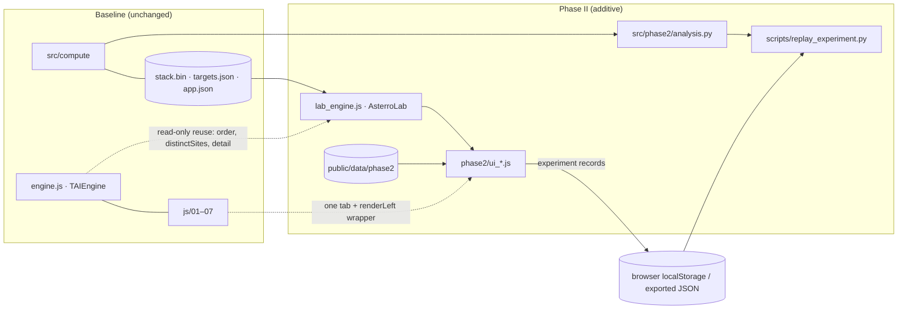

# ASTERRO Phase II — Architecture

Phase II adds a **Research Laboratory** beside the baseline ASTERRO engine. The baseline is a
protected production system: its scoring engine, weights, normalisation, thresholds, ranking,
data, targets and interface are unchanged (see [BASELINE_PRESERVATION.md](BASELINE_PRESERVATION.md)).

## 1. The baseline system

| Part | Location | Role |
|---|---|---|
| Static page | `app/frontend/index.src.html` → `public/index.html` | Single page; CSS and JS are inlined by `scripts/build_web.py` |
| Baseline engine | `app/frontend/engine.js` (`TAIEngine`) | Similarity, ranking, distinct sites, constellations. Bit-identical to `src/compute/*.py` |
| UI modules | `app/frontend/js/01_core … 07_main.js` | State `S`, globe, compute pipeline, views, console, sheets, wiring |
| Python reference | `src/compute/` | `similarity` (formula, coverage, cross-planet min), `ranking`, `clustering`, `sensitivity` |
| Data | `public/data/stack.bin` (SHA-256 `cfbe1bf5…`), `app.json`, `targets.json`, `labels.json` | Valid-cell predictor stack, registry, targets |
| Provenance | `data/provenance/manifest.json`, `data/metadata/*` | Raw-input checksums, scripts, verified / unverified lists |
| Tests | `tests/test_*.py`, `tests/test_js_parity.mjs`, `tests/ui_smoke.py` | 36 Python tests, JS ≡ Python parity, UI walk-through |

Entry points:

- the page loads data in `loadAll()` (01_core);
- `boot()` then calls `compute()` and `wire()` (07_main);
- tabs are rendered through `renderLeft()` (04_views).

## 2. Extension points used

There are only two extension points, both at run time and both reversible:

1. **One tab button appended** to the existing tab bar, labelled "Lab". It is created by
   `ui_01_core.js` before `wire()` runs, so the baseline `setTab()` handles it like any other tab.
   No existing label or position changes.
2. **`renderLeft()` wrapped by assignment.** The wrapper renders the Lab only when `S.tab === "lab"`.
   For every other tab it calls the original function with the original arguments. Baseline
   function declarations are never redeclared; a test (`tests/phase2/test_lab_engine.mjs`,
   section 12) fails if any Phase II top-level name would shadow a baseline name.

The build integration is a five-line additive change to `scripts/build_web.py`. It appends
`app/frontend/phase2/*.js` after the baseline modules and `phase2/*.css` after `styles.css`.

## 3. New modules

```
app/frontend/phase2/
  lab_engine.js      AsterroLab — pure, deterministic analysis functions (browser + Node, UMD)
  ui_01_core.js      Lab state, lazy checksummed data loading, router, evidence-claim rendering, vault storage
  ui_02_robust.js    Analogue Robustness Laboratory (designs, ranking stability, OAT sensitivity, ablation)
  ui_03_portfolio.js Multi-Objective Analogue Discovery (Pareto, diversity, portfolio comparison)
  ui_04_atlas.js     Spatial Analogue Microclimate Atlas (window statistics, scale ladder, target windows)
  ui_05_uncert.js    Planetary Uncertainty Explorer
  ui_06_failure.js   Analogue Failure-Mode Laboratory (losses, missing factors, counterexamples)
  ui_07_graph.js     Planetary Evidence Graph
  ui_08_xplanet.js   Cross-Planet Evidence Comparator
  ui_09_temporal.js  Planetary Analogue Evolution Observatory
  ui_10_reqs.js      Mission Requirement Translator
  ui_11_obsval.js    Observation Value Engine (qualitative; formal VOI blocked)
  ui_12_planner.js   Analogue Research Mission Planner
  ui_13_vault.js     Scientific Reproducibility Vault
  ui_14_review.js    Scientific Review (deterministic; language-model copilot not implemented)
  lab.css            Styles scoped to new class names
src/phase2/
  analysis.py        Python reference implementation (independent code) of the Lab analyses
  catalog.py         Editorial catalogues: requirement variables, missing factors, activities, uncertainty sources, scales
scripts/
  build_phase2_data.py   Phase II data products → public/data/phase2/
  replay_experiment.py   Independent Python replay of browser experiment records
public/data/phase2/
  context.json       Target-window distributions, MEDA per-sol ground temperatures, catalogues, provenance manifest, checksums
  series.b64.txt     POWER monthly T2M / precipitation, MODIS yearly pixel-month counts, GMTED pixel counts (lazy, ~7 MB)
tests/phase2/        Node engine tests, UI walk-through, JS evaluator for parity, fixtures (browser-exported records)
tests/test_phase2.py Python parity, data integrity, replay, baseline preservation (picked up by the existing runner)
```



## 4. Data flow and separation of outputs

- **A · Baseline Analogue Score.** Always read from `S.res`, or recomputed by `TAIEngine` with the
  user's current configuration. Phase II never writes `S.weights`, `S.res`, `S.ranges` or `S.T`.
- **B · New analytical metrics.** Every experiment computes on copies: `AsterroLab.prepare()`
  builds per-criterion similarity arrays with the baseline formula, and `fieldScore()` accumulates
  them in the baseline order. As a result, the baseline configuration reproduces `TAIEngine` scores
  **bit-for-bit** (tested for every mission profile and both targets).
- **C · Engineering / mission considerations.** These exist only as user-defined requirements
  (Mission Requirement Translator) and editorial checklists (`catalog.ACTIVITIES`). Neither
  contains a threshold supplied by ASTERRO.
- **D · Evidence gaps.** These are recorded as `UNAVAILABLE`, `UNVALIDATED` or `ASSUMED` claims,
  using proxy / N/A statuses, manifest `unverified` items and the `SUBCELL_MSG` statement.

These four kinds are never combined into one number.

## 5. Evidence-before-assertion protocol

`AsterroLab.claim()` validates every significant claim. Each claim has an id, text, category,
supporting data, method, provenance, assumptions, limitations, completeness and reproduce fields.

- The categories are MEASURED, DERIVED, INFERRED, ASSUMED, UNAVAILABLE and UNVALIDATED.
- A MEASURED claim without provenance is rejected, as is a DERIVED or INFERRED claim without a
  method, and an UNAVAILABLE claim with non-empty completeness.
- Claims are shown in each module under "Evidence record" and stored with Vault records.

## 6. Reproducibility

Each Lab run writes an **experiment record** (`schema asterro.experiment/1`) containing:

- **Baseline snapshot:** target, weights, profile, normalisation ranges, rules, stack SHA-256,
  file hashes, dataset versions, algorithm and Phase II versions.
- **Run data:** parameters (including seeds) and outputs.
- **Integrity:** the record id is `SHA-256(canonical JSON of config)[:16]`, and the outputs carry
  their own SHA-256.
- **Notes:** claims and limitations.

Canonical JSON is implemented identically in JavaScript and Python, and a test checks this.
Records can be verified, replayed in the browser, compared and exported. Robustness and ablation
records are also replayed by `scripts/replay_experiment.py` using independent Python code.

## 7. Performance

Measured on the actual 76,781-cell dataset (container CPU; headless Chromium with software WebGL):

| Operation | Measured |
|---|---|
| Factorial robustness, 729 configurations × 20 candidates (Node, `test_lab_engine.mjs`) | 3.9 s |
| Same, in the browser, including UI rendering (Lab smoke test) | 5.2 s, progress bar, cancellable |
| Criterion ablation, 6 full re-rankings with distinct-site selection | 0.3 s |
| Python replay of the factorial record (independent implementation) | 11.9 s |
| Page start-up to data ready, baseline build vs Phase II build (4 runs each) | 0.75–1.09 s vs 0.86–0.90 s |
| Phase II data requested at start-up | none; loaded only when a Lab module needs it |

**How the cost is kept low.**

- **Ranks:** candidate ranks are computed exactly without sorting, in O(n log k) per configuration.
- **Shared arrays:** per-criterion similarity arrays are cached per target, so each configuration
  is one weighted sum.
- **Cache safety:** cached results are keyed by target and weights, and are never reused for a
  different configuration (stale results are flagged).
- **Large data:** the 7 MB series file loads on demand and is verified against its checksum.

## 8. Failure handling

- **Module errors:** each Lab view runs inside try/catch. A failing module shows "This module
  failed … The baseline application is unaffected" instead of breaking the page.
- **Missing data:** missing optional data (context or series) gives an explicit message, and a
  checksum mismatch stops that data from being used.
- **Storage:** when browser storage is unavailable, records stay in memory, and the Vault says so.
